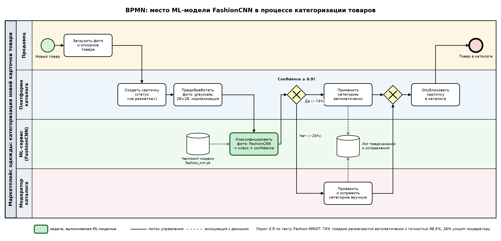
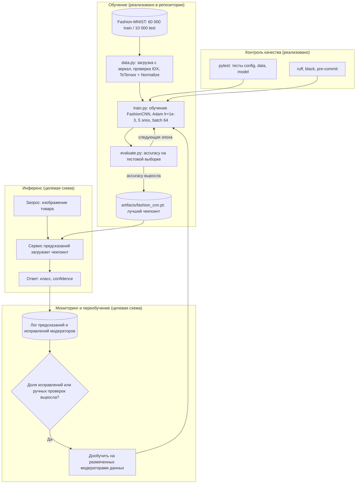

# Место модели FashionCNN в процессе проекта

Документ показывает, где модель `FashionCNN` (см. [model_card.md](model_card.md)) находится в бизнес-процессе и в техническом конвейере проекта.

**Бизнес-контекст.** Интернет-магазин или маркетплейс одежды ежедневно получает от продавцов новые товары. Каждой карточке нужно присвоить категорию (футболка, брюки, платье, кроссовки, сумка и т. д.), от неё зависят поиск, фильтры каталога и рекомендации. Сейчас категорию проставляет модератор вручную. Модель автоматизирует этот шаг.

## 1. Бизнес-процесс: категоризация новой карточки товара

Схема в нотации, близкой к BPMN: дорожки (pools/lanes) соответствуют участникам, ромбы — шлюзам (gateways), скруглённые блоки — событиям начала и конца.

## 2. Технический процесс: жизненный цикл модели

Схема показывает, как модель создаётся в этом репозитории и как попадает в бизнес-процесс выше. Блоки, отмеченные «реализовано», есть в коде; остальные — целевая схема внедрения.

## 3. Описание

### Какую задачу в процессе решает модель

Модель выполняет шаг **«определить категорию товара по фотографии»**. Это классификация изображения в один из 10 классов: T-shirt/top, Trouser, Pullover, Dress, Coat, Sandal, Shirt, Sneaker, Bag, Ankle boot. Модель заменяет ручную разметку для большинства товаров и выдаёт оценку уверенности, по которой процесс решает, нужна ли проверка человеком.

### Почему для этой задачи целесообразно использовать ML

- **Правила здесь не работают.** Категорию определяет форма силуэта, а не набор простых признаков. Написать вручную правила «по пикселям», которые отличат пуловер от пальто, практически невозможно. Свёрточная сеть сама выучивает нужные признаки (края, контуры, форму рукавов и подошвы) из 60 000 размеченных примеров.
- **Объём и скорость.** Модератор тратит секунды на каждую карточку, а модель размечает 10 000 изображений примерно за 2 секунды на обычном CPU. Новые товары появляются в каталоге без очереди на модерацию.
- **Качество достаточно для автоматизации.** Accuracy 91.15% на всех товарах, а при пороге уверенности 0.9 — 98.55% на 74% товаров. Это сопоставимо с качеством ручной разметки и снимает с модераторов около трёх четвертей работы.
- **Управляемый риск.** Модель выдаёт вероятность, поэтому неуверенные случаи (в основном рубашки, футболки, пуловеры и пальто) можно отправлять человеку, а не применять вслепую.
- **Дешёвая модель.** 42 тысячи параметров (около 170 КБ), не требует GPU в продакшене.

### Какие данные поступают на вход модели

- **При обучении:** датасет Fashion-MNIST — 60 000 изображений одежды и обуви с метками классов (по 6 000 на класс), плюс 10 000 тестовых изображений для оценки.
- **При работе в процессе:** фотография товара, загруженная продавцом, после предобработки до формата обучающих данных: одноканальное (grayscale) изображение 28×28, предмет по центру, значения нормализованы в диапазон −1..1 (`ToTensor` + `Normalize(0.5, 0.5)`). Модель принимает батч тензоров формы `[N, 1, 28, 28]`.
- Текстовое описание, цена и другие атрибуты товара на вход модели **не подаются**: она работает только с изображением.

### Как результат работы модели используется дальше в процессе

1. Модель возвращает 10 логитов. Сервис превращает их в вероятности (softmax) и выбирает класс с максимальной вероятностью; эта вероятность и есть confidence.
2. **Шлюз по порогу уверенности:**
   - confidence ≥ 0.9 → категория автоматически записывается в карточку, товар сразу публикуется в нужном разделе каталога;
   - confidence < 0.9 → карточка уходит в очередь модератора, где предсказание модели показывается как подсказка, а модератор подтверждает его или исправляет.
3. Опубликованная категория используется в поиске, фильтрах каталога и рекомендательных блоках («похожие товары»).
4. Все предсказания и исправления модераторов логируются. Эти данные служат для мониторинга качества (доля ручных проверок, доля исправлений, распределение классов) и становятся новой размеченной выборкой для дообучения модели. После дообучения новый чекпоинт проходит тот же цикл `train` → `evaluate` и заменяет текущий в сервисе.

Порог 0.9 выбран по таблице «качество в зависимости от порога» из [model_card.md](model_card.md#8-количественный-анализ-quantitative-analyses). Бизнес может сдвигать его: более низкий порог даёт больше авторазметки и больше ошибок, более высокий — меньше ошибок и больше ручной работы.
