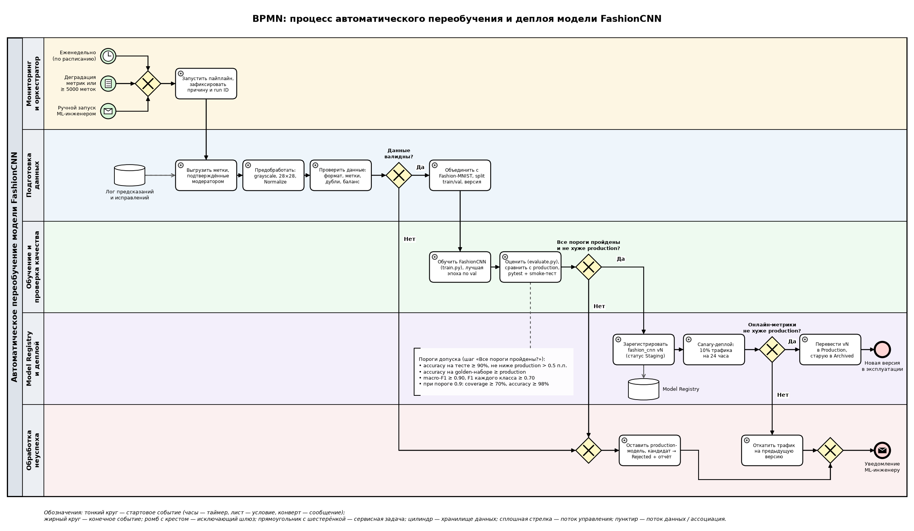

# Процесс автоматического переобучения модели FashionCNN

Документ описывает, как модель `FashionCNN` (см. [model_card.md](model_card.md)) автоматически переобучается и выкатывается в эксплуатацию: от срабатывания триггера до развертывания новой версии. Место модели в бизнес-процессе описано в [Model_BPMN.md](Model_BPMN.md).

**Что уже есть в репозитории:** загрузка и проверка данных (`data.py`), обучение с выбором лучшего чекпоинта (`train.py`), оценка accuracy (`evaluate.py`), конфигурация (`TrainConfig`), unit-тесты (`pytest`). **Целевая схема (оркестрация):** пайплайн запускается оркестратором (Airflow DAG или GitHub Actions по расписанию), который вызывает эти модули как шаги и добавляет триггеры, проверки, реестр и деплой.

## 1. Схема процесса (BPMN 2.0)

Исходник схемы в формате BPMN 2.0 XML: [Model_retrain.bpmn](Model_retrain.bpmn). Его можно открыть и отредактировать в [Camunda Modeler](https://camunda.com/download/modeler/) или на [demo.bpmn.io](https://demo.bpmn.io/).

Элементы схемы:

- **Пул** «Автоматическое переобучение модели FashionCNN» с пятью дорожками: мониторинг и оркестратор, подготовка данных, обучение и проверка качества, Model Registry и деплой, обработка неуспеха.
- **Стартовые события:** таймер (раз в неделю), условное событие (деградация онлайн-метрик или накопление 5 000 новых меток), сообщение (ручной запуск ML-инженером). Они сводятся исключающим шлюзом в один запуск пайплайна.
- **Исключающие шлюзы-решения:** «Данные валидны?», «Все пороги пройдены и не хуже production?», «Онлайн-метрики не хуже production?».
- **Конечные события:** «Новая версия в эксплуатации» при успехе и «Уведомление ML-инженеру» (событие-сообщение) при любом неуспехе.
- **Хранилища данных:** лог предсказаний и исправлений (источник новых меток) и Model Registry (куда регистрируется новая версия).
- **Аннотация** с порогами допуска к публикации, привязанная к шагу оценки качества.

## 2. Описание этапов

| № | Этап | Что происходит | Результат на следующий шаг |
|---|---|---|---|
| 1 | **Триггер** | Пайплайн запускается при любом из событий: плановый запуск раз в неделю; деградация онлайн-метрик (модераторы исправляют более 5% автоматически проставленных категорий или на ручную проверку уходит более 35% товаров при норме ~26%); накопилось 5 000 новых размеченных фото; ручной запуск. | Событие запуска с причиной и временем, ID запуска пайплайна. |
| 2 | **Получение и подготовка данных** | Из лога предсказаний выгружаются товары, категория которых подтверждена или исправлена модератором (это и есть новые метки). Фото приводятся к формату модели: grayscale, 28×28, `Normalize(0.5, 0.5)`. Проверяются формат и размер изображений, корректность меток (0..9), дубликаты, баланс классов (ни один класс не меньше 5% выборки). Новые данные объединяются с Fashion-MNIST train, выделяется валидационная выборка 10%. | Версионированный датасет train/val с хэшем и статистикой. При провале валидации — переход к этапу 8. |
| 3 | **Обучение новой версии** | `train.py` обучает `FashionCNN` с параметрами из `TrainConfig` (Adam, lr 1e-3, batch 64, 5 эпох, seed 42). Лучшая эпоха выбирается по accuracy на **валидационной** выборке, а не на тесте. | Модель-кандидат: файл весов, конфиг, версия датасета, git commit кода, кривые обучения. |
| 4 | **Проверка качества** | `evaluate.py` считает метрики на двух неизменяемых наборах: тест Fashion-MNIST (10 000 изображений) и golden-набор реальных фото каталога, размеченных модераторами. Кандидат сравнивается с текущей production-моделью на тех же данных. Запускаются `pytest` и smoke-тест (чекпоинт загружается, выход имеет форму `[N, 10]`). | Отчёт с метриками кандидата и production-модели и списком пройденных и непройденных проверок. |
| 5 | **Решение о публикации** | Автоматический шлюз: кандидат публикуется, только если выполнены **все** условия из таблицы ниже. | «Да» → регистрация; «Нет» → этап 8. |
| 6 | **Регистрация версии** | Кандидат сохраняется в Model Registry (например, MLflow) как `fashion_cnn vN` со статусом `Staging`. Вместе с весами сохраняются метрики, отчёт, версия данных и git commit — это позволяет воспроизвести и откатить любую версию. | Зарегистрированная версия `vN`, готовая к деплою. |
| 7 | **Деплой** | Сервис предсказаний загружает `vN` в режиме canary: новая модель обслуживает 10% запросов в течение 24 часов, остальные идут на текущую версию. Сравниваются онлайн-метрики: доля исправлений модератором, доля ручных проверок, время ответа, ошибки сервиса. Если canary не хуже — `vN` переводится в `Production`, предыдущая версия в `Archived`. | Новая версия обслуживает 100% трафика; мониторинг продолжает отслеживать триггеры этапа 1. |
| 8 | **Неуспешные проверки** | Если не прошла валидация данных или проверка качества — пайплайн останавливается, production-модель не меняется, кандидат сохраняется со статусом `Rejected` и отчётом о причинах. Если canary хуже production — трафик автоматически возвращается на предыдущую версию (откат). Во всех случаях ML-инженеру уходит уведомление. | Отчёт об ошибке и задача на разбор; в эксплуатации остаётся проверенная модель. |

### Условия допуска новой версии в эксплуатацию (этап 5)

Пороги заданы относительно текущей версии модели (результаты из [model_card.md](model_card.md): accuracy 91.15%, F1 класса Shirt 0.743, coverage 73.7% при точности 98.55% на пороге 0.9).

| Проверка | Условие прохождения |
|---|---|
| Accuracy на тесте Fashion-MNIST | ≥ 90% и не ниже production более чем на 0.5 п.п. |
| Accuracy на golden-наборе реальных фото | ≥ accuracy production-модели |
| Macro-F1 | ≥ 0.90 |
| F1 по каждому классу | ≥ 0.70 (защита от деградации «слабых» классов, прежде всего Shirt) |
| Порог уверенности 0.9 | coverage ≥ 70% и accuracy на этой доле ≥ 98% |
| Время инференса на CPU | не более чем на 20% хуже production |
| Тесты | `pytest` и smoke-тест проходят без ошибок |

Новая модель попадает в эксплуатацию только при выполнении трёх условий подряд: данные прошли валидацию, все офлайн-проверки из таблицы пройдены, и на canary-трафике онлайн-метрики не хуже текущей версии. В любом другом случае в эксплуатации остаётся текущая модель.
